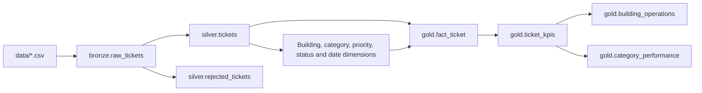

# Ticket medallion

The local pipeline uses PySpark and PostgreSQL to turn facilities-support tickets
into reports on workload by building and recorded cost by maintenance category.
The [Data Quality and Gold Design agents](src/agents/README.md) generate reviewable
pipeline components with human approval, evaluations, and recorded live examples.

PostgreSQL schemas separate raw evidence (`bronze`), validated tickets (`silver`),
and reporting models (`gold`). Keeping them in one local database makes it possible
to follow a reported ticket back to its source row with a SQL join.

## Prerequisites

- uv; Python 3.12 is selected through `.python-version` and `pyproject.toml`.
- Java 17 or 21 on `PATH`, or a valid `JAVA_HOME`.
- A running PostgreSQL server. Initial setup requires a user with permission to
  create the project database and schemas, and access to the `postgres` maintenance database.

## Run from a fresh clone

From the repository root, with PostgreSQL running, use this command to install
locked dependencies, initialize the database, and process the included CSV.

```bash
uv sync --locked && uv run --locked python -m src.migrations.runner && uv run --locked python -m src.cli
```

The default connection is `::1:5432`, database `ticket_medallion`, with the
operating-system username. Set `PGHOST`, `PGPORT`, `PGDATABASE`, `PGUSER`, or
`PGPASSWORD` in the shell before running the command if your setup differs.
Keep credentials outside Git. The CLI reads the environment directly.

## Dependencies

| Dependency | Purpose |
| --- | --- |
| Python 3.12 (tested: 3.12.7) | Project runtime |
| PySpark 4.3.0 | Typed bronze records, silver transformations and deduplication |
| psycopg 3.3.8 with binary extras | Transactional PostgreSQL ingestion; no local compilation |
| LangGraph 1.2.20 | Agent workflows |
| LangChain 1.4.9 | LLM integration |
| langchain-openai 1.7.4 | Installed provider adapter; provider/model choice remains provisional |

Exact Python library versions are recorded in `uv.lock`. Java and PostgreSQL
are managed separately from uv. The current pipeline does not require JDBC.

## Database initialization

The runner creates the configured database if absent, then applies numbered SQL
migrations in order. Each migration and its checksum record commit together;
failure rolls back that migration and stops execution. Rerunning skips matching
applied migrations and rejects changed checksums. Add a new migration to make
further structural changes; do not edit applied SQL files.

Database creation runs separately because PostgreSQL requires it outside a
transaction. `000_create_database.sql` remains a standalone manual bootstrap;
the runner creates the configured database directly and does not execute or
record that helper. The first transactional migration creates the history table.
Initialization and pipeline runs share a database lock so they cannot overlap.

## Run bronze → silver → gold

Place incoming CSV files directly inside `data/`, then run from the repository root:

```bash
uv run --locked python -m src.cli
```

The command ingests and archives pending CSVs, then rebuilds `silver.tickets` and
`silver.rejected_tickets` from all bronze records. Gold then publishes one fact
per accepted ticket. With an empty inbox, the same command rebuilds silver and
gold from existing data. One Spark session and database connection serve the run.

## File lifecycle and retries

- CSV files directly in `data/` are pending, active, or interrupted inputs.
  Subdirectories are not scanned, and files run in filename order.
- Each file's SHA-256 identifies its content, regardless of filename.
  A committed file hash is skipped on subsequent arrivals.
- New file metadata and all its records commit in one transaction.
  `bronze.ingested_files` stores the original filename, file SHA-256, row count,
  and `ingested_at`. Each row in `bronze.raw_tickets` links to that file by hash
  and carries a record number, original CSV record text, parsed string fields
  in JSONB, and a row hash. Keeping the fields as strings defers business types
  to silver (schema-on-read). Repeated source rows retain separate record numbers.
- Only after ingestion succeeds does the file move into `data/processed/`.
  A different file at the destination is never overwritten.
- Failed ingestion rolls back that file and leaves it pending. Earlier files
  remain committed, and the run stops with a nonzero exit status.
- If archiving fails after commit, retry the same command. The committed hash
  prevents duplicate ingestion while archiving is retried. An identical file
  already at the destination is safe to recover; different content needs a
  filename conflict resolved before retrying.
- A PostgreSQL session lock prevents concurrent CLI runs. Logs report filenames,
  inserted counts, skips, safe validation explanations, and database error codes
  (SQLSTATE). Raw database error messages are withheld to avoid exposing credentials
  or ticket content.

Incoming files must be fully written before running the pipeline and remain
unchanged during processing. Archiving uses a hard link followed by source removal,
so `data/` and `data/processed/` must be on the same filesystem. Local DataFrame
construction holds records in driver memory; larger inputs need distributed reads.

The sample CSV remains version-controlled at `data/raw_tickets.csv`. Processing
moves its local copy into the ignored `data/processed/` directory, so Git reports
the original path as deleted afterward. Do not commit that deletion if retaining
the sample for fresh clones.

## Silver rules

Bronze remains unchanged. Silver retains a reference to each source record and
stores quality flags; ordinary field problems do not discard the whole ticket.

| Column | Cleaning and interpretation |
| --- | --- |
| `ticket_id` | Require `TKT-` followed by digits. Missing (`empty`, `N/A`, `NULL`) or malformed IDs go to `silver.rejected_tickets`. Never invent identifiers. |
| `created_at` | Parse observed formats and month-first numeric dates. Missing/invalid values become null with flags; retain date/minute/second precision. |
| `resolved_at` | Same parsing rules. Missing is allowed for unresolved tickets; flag missing terminal dates, invalid values, and status/date inconsistencies without changing status. |
| `category` | Use fixed aliases in `CATEGORY_ALIASES` in `src/pipeline/silver.py`. Repair recognized category/description swaps and flag them; unknown/junk labels become null. Explicit Other/Misc remains `other`. |
| `priority` | Normalize low/lo, medium/med/Normal, high/hi, and critical/crit. Missing and ambiguous ASAP/urgent values become null with distinct flags; no default priority. |
| `status` | Normalize six statuses: open, in_progress, pending_vendor, escalated, resolved, closed. Keep resolved/closed distinct; unknown status becomes null. Never infer it from notes. |
| `building` | Preserve names; missing tokens become null. Retain and flag test building; do not invent a location hierarchy. |
| `description` | Apply approved swaps, preserve prose and Unicode, null empty/NULL, and flag suspected junk without following its instructions. No text-based ticket deduplication. |
| `submitted_by` | Trim and proper-case only; never merge initials, nicknames, or identities. Flag missing/test values and retain account labels. |
| `assigned_to` | Preserve company spelling and Joe (in-house); capitalize generic team/role labels. Missing becomes null and flagged; do not infer assignments. |
| `resolution_notes` | Null empty notes; preserve short notes, case, and wording. Progress notes on unresolved tickets are allowed; no automatic extraction or status changes. |
| `cost` | Remove the observed dollar prefix and parse exact decimals. Missing tokens become null/missing; errors, negatives (including -1/-999), non-finite or unrepresentable values become null/invalid. Preserve zero and high costs; do not assume or convert currency. |
| `sla_hours` | Parse nonnegative integers. Missing tokens become null/missing; negatives and invalid integers become null/invalid. Preserve 0/999 with a requires-confirmation flag; exclude them from default SLA metrics. Never infer SLA from priority. |

The source profile informed these choices. All 10,254 well-formed IDs were
distinct, so fabricating IDs for the other 26 rows would obscure which tickets
actually exist. Unambiguous numeric dates supported month-first parsing. Time
was absent from 1,956 creation dates, which makes hourly duration unreliable.
In 49 rows the category contained descriptive text and the description was a
known category label, giving a specific condition for a repair.

Of 195 negative costs, 192 were `-1` and three were `-999`. Their meaning is
undocumented, so silver flags them and excludes them from recorded spending.
The 484 zero-hour and 557 999-hour SLA values also lack a documented business
meaning. Silver retains both values for review.

Timestamps use PostgreSQL `timestamp without time zone` and Spark `TIMESTAMP_NTZ`
to preserve source clock readings. Each has separate precision and timezone fields:
Unix seconds produce UTC clock readings labelled `UTC`; other source timezones
remain null/unknown. Date-only values use midnight with precision `date`, not an
invented observation time. Hourly metrics require sufficient precision and a
known, compatible timezone; unknown-zone values are not silently treated as UTC.

Identical source payloads deduplicate by ticket ID, choosing the lowest file hash
and record number as deterministic lineage. Different source payloads sharing a
valid ID stop publication until an update policy is approved; arrival order does
not establish a newer ticket state.

Both silver tables are staged and replaced in one transaction. A failed silver
refresh preserves the previous published silver tables; completed bronze ingestions
and archived source files remain intact. Rerun the command after resolving the
failure; silver rebuilds from bronze without needing the incoming files restored.

## Gold models



`gold.fact_ticket` stores the current status and cost through a status key and a
nullable recorded amount, plus the ticket ID and bronze lineage. It joins to
`dim_building`, `dim_category`, `dim_priority`, and `dim_status` by stable keys.
Each has an Unknown member (key 0). Created and resolved dates both reference
`dim_date`, using the calendar day of the silver clock reading.

Each gold refresh inserts new buildings and dates and replaces the fact rows
in one transaction. A failure rolls back that publication. Confirmed dimension
corrections use Type 1 updates in place, preserving the key. A building rename
also requires the corresponding silver mapping so future loads reuse that key.

| Reporting view | Grain and purpose |
| --- | --- |
| `gold.ticket_kpis` | One row per accepted ticket. Supplies shared indicators and supports drill-down to individual tickets. |
| `gold.building_operations` | One row per building. Shows where unresolved and critical work is concentrated. |
| `gold.category_performance` | One row per maintenance category. Shows which kinds of work account for demand and recorded cost. |

Both summaries group the same ticket indicators, including Unknown groups.

| KPI | Calculation within each group |
| --- | --- |
| Total, terminal, unresolved, unknown status | Count all tickets. Count resolved/closed as terminal, open/in progress/pending vendor/escalated as unresolved, and unknown status separately. The three counts sum to the total. |
| Critical unresolved | Count unresolved tickets whose priority is critical. |
| Terminal rate (%) | 100 × terminal tickets / tickets with known status. A zero denominator yields null. |
| Tickets with recorded cost, cost coverage (%) | Count non-null costs, including zero. Coverage is 100 × that count / total tickets. |
| Total and average recorded cost | Sum the recorded amounts. Divide that sum by tickets with recorded cost for the average. Both return null for groups with no recorded amounts. |

Cost figures use source units. Each report describes the current ticket snapshot.

## At 100× scale

At roughly one million rows with daily arrivals, the first bottlenecks would be
collecting bronze in Python driver memory and rebuilding all silver and gold rows
on every run. The proposed changes for that workload are:

- **Read and load in partitions.** Keep file hashes and record-level lineage.
  Stream or partition incoming batches and bulk-load their records within bounded
  transactions. Publish a batch as complete only after all its rows reconcile.
- **Process changed ticket IDs.** Use committed batch IDs to select new work so
  late arrivals are picked up regardless of creation date. Compare those IDs
  with existing versions, preserve the conflict policy, and checkpoint after a
  successful publish. Backfills can replay a chosen set of batches.
- **Refresh affected gold facts.** Update facts by ticket ID and reuse dimension
  keys. At 10M rows, measure the two reporting queries before materializing them.
  If summaries are stored, recompute both old and new groups when a ticket moves.
  Recalculate rates from counts so partial refreshes preserve their denominators.

## Verified behavior

On 7 November 2026, the supplied CSV was ingested on macOS ARM64 with Java
17.0.16 and PostgreSQL 14.17. All 10,280 database records matched source text,
parsed fields, and hashes; the archived file was byte-identical. A rerun added
no records. Temporary checks also covered duplicate arrivals, transaction rollback,
archive recovery, and CLI failure handling; no permanent test suite is included.
Silver validation used a disposable database with all 10,280 source records:
10,254 accepted tickets and 26 rejected IDs. Checks covered deterministic reruns,
duplicate/conflicting payloads, real database locking, and rollback of both tables
on a forced publication failure.
The combined CLI was also validated in a disposable database: first-run ingestion,
silver refresh with no new files, restoration of a missing silver row on rerun,
and preservation of published silver when a new bronze batch introduced a conflict.

The combined command was then run against the project database on 7 November 2026:
10,254 cleaned tickets and 26 rejected IDs (22 missing, 4 malformed). Every published
field and bronze reference was verified, including 49 category/description repairs
and one category recovery. A second run produced identical silver rows, flags,
lineage, and rejections while preserving bronze metadata and the archived CSV.

Gold contained 10,254 facts on 7 November 2026. All KPIs matched independent
aggregations of silver for each of the 19 building groups and 12 category groups.
The 6,452 tickets with recorded costs totaled 38,365,957.76 source units
(62.92% cost coverage).

A fresh checkout of commit `181af3b` passed locked installation, database
initialization, and a complete run against a disposable PostgreSQL database.
Delivering the identical CSV under a second filename left every bronze, silver,
gold, and migration table and reporting view identical to the first run.
