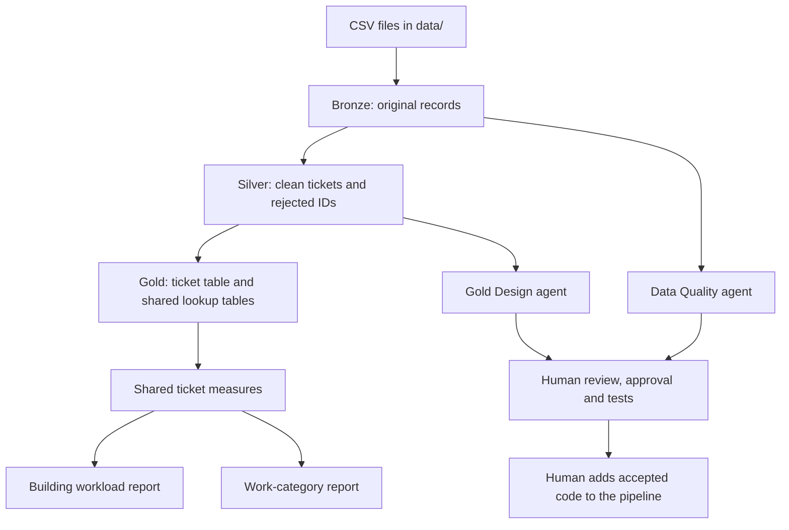

# Ticket reports

This project converts facilities-support tickets into clean data and reports.
PySpark processes the files. PostgreSQL stores the results. Two AI agents help
write code for human review. Normal pipeline runs do not call an AI model.

## 1. How to run

Install **uv**, **Java 17 or 21**, and **PostgreSQL**. Start PostgreSQL before you
run the project. Your database account must have permission to create databases.
uv manages the Python packages; Java and PostgreSQL are separate installations.

Open a terminal in the repository folder, which contains `pyproject.toml`.
The project uses Python 3.12 and the package versions in `uv.lock`.

The default database settings are:

| Setting | Default | Terminal variable to change it |
| --- | --- | --- |
| Server address | `::1` (this computer) | `PGHOST` |
| Port | `5432` | `PGPORT` |
| Database name | `ticket_medallion` | `PGDATABASE` |
| Database user | Your operating-system username | `PGUSER` |
| Password | Not set by the project | `PGPASSWORD` |

For example, use `export PGUSER="your_database_user"` to select another account.
Then run this single command:

```bash
uv sync --locked && uv run --locked python -m src.migrations.runner && uv run --locked python -m src.cli
```

It installs Python packages, creates the database and tables, and processes the
included CSV file. The sample produces 10,254 accepted tickets and 26 rejected IDs.

For later runs, put complete CSV files directly in `data/`, then run:

```bash
uv run --locked python -m src.cli
```

Successful files move to `data/processed/` without changing their contents.
Keep both folders on the same storage volume. The sample file remains in Git;
do not commit its local deletion after processing.

## 2. Architecture and layer separation



A PostgreSQL **schema** is a named group of tables. One database contains three schemas:

| Schema | Stored data | Reason for separation |
| --- | --- | --- |
| `bronze` | Original CSV record text, parsed text fields, source filename, load time and hashes | Preserve evidence and trace results to their source. |
| `silver` | Clean, typed tickets, issue flags and rejected IDs | Apply business rules without changing the original records. |
| `gold` | Ticket measures and reporting views | Give reports a shared set of definitions. |

Bronze keeps field values as text. Silver assigns types when it reads them.
This is **schema-on-read**: interpret the source after saving it.

A **hash** is a fingerprint calculated from data. File hashes prevent repeat
loads, even when a file is renamed. Row hashes track matching source records.
Failed loads roll back their database changes. A failed silver or gold stage
preserves that stage's previous results. Logs show stage outcomes and row counts.

## 3. Silver cleaning rules

Missing or invalid fields use SQL `NULL`, which means no value.
Issue flags explain the reason. Most field errors do not reject the whole ticket.
SLA means service level agreement. The source SLA hours need business confirmation.

| Field | Rule | Reason |
| --- | --- | --- |
| `ticket_id` | Require `TKT-` followed by digits. Send other IDs to the rejected table. | Do not invent ticket identities. |
| `created_at`, `resolved_at` | Parse observed formats; use month-first numeric dates. Keep date/time precision and timezone information. Flag invalid dates and status/date conflicts. | Avoid false event times. |
| `category` | Map known spellings. Repair recognized category/description swaps. Leave unrecognized categories empty. | Make categories consistent without guessing. |
| `priority` | Map known spellings to low, medium, high or critical. Leave ambiguous values empty. | Do not invent urgency. |
| `status` | Map known spellings to open, in_progress, pending_vendor, escalated, resolved or closed. Leave unknown values empty. | Keep reporting groups consistent. |
| `building` | Keep names; mark missing and test values. | Do not invent locations. |
| `description` | Keep wording and characters. Apply approved swaps and flag suspected junk. | Preserve the ticket's meaning. |
| `submitted_by` | Trim spaces and apply proper case. Flag missing values. Never merge identities. | Similar names can identify different people. |
| `assigned_to` | Keep company spelling. Standardize generic team labels; flag missing values. | Preserve assignment identity. |
| `resolution_notes` | Keep wording and case. Remove empty placeholders. | Notes do not prove a ticket is complete. |
| `cost` | Parse exact decimals and remove the observed dollar prefix. Keep zero. Flag missing, negative or invalid values separately. | Missing cost must not count as zero spending. |
| `sla_hours` | Parse whole, nonnegative hours. Keep 0 and 999, but flag them for confirmation. | These target-time values have no confirmed business meaning. |

The source supports month-first dates and contains 49 category/description swaps.
Negative costs include `-1` and `-999`; their meaning is undocumented.
Text dates have no confirmed timezone. Hourly duration measures are therefore excluded.

Exact duplicate tickets collapse to one record. Different data for the same valid
ticket ID stops publication: the source gives no reliable update order.

## 4. Gold models and their purpose

`gold.fact_ticket` stores one row per accepted ticket. Shared lookup tables
(**dimensions**) describe buildings, categories, priorities, statuses and dates.
Missing lookup values use an Unknown entry, so reports keep those tickets.

The three reporting models are database **views**: saved queries over these tables.

| Model | Each row describes | Business purpose |
| --- | --- | --- |
| `gold.ticket_kpis` | One ticket and its calculated measures | Define measures once for both reports. KPI means key performance indicator. |
| `gold.building_operations` | One building | Identify buildings with unresolved or critical work. |
| `gold.category_performance` | One maintenance category | Compare demand and recorded spending by type of work. |

Resolved and closed tickets count as complete. Other known statuses count as
unresolved. Unknown statuses remain separate. Critical unresolved tickets have
both a critical priority and an unresolved status.

Completion rate is completed tickets divided by tickets with known status.
Cost coverage is tickets with recorded cost divided by all tickets.
Both rates are percentages. Cost totals and averages include recorded zero costs
and exclude missing costs. Groups without recorded costs have no total or average.
The source currency is unknown; no currency conversion is applied.

## 5. Agent assessment and use

LangGraph controls the agent workflow. LangChain connects it to OpenAI's
`gpt-6-luna` model. Each agent receives data summaries, table definitions,
approved rules and the user's request. Generated code requires human review.

### Data Quality agent

- **Input:** A bronze data summary and cleaning rules. Example request: “Generate cost and SLA cleaning.”
- **Output:** A PySpark cleaning function. For example, `$12.50` becomes `12.50`; `-999` becomes `NULL` with a `cost_invalid` flag.
- **Assessment:** Five drafts were needed to correct number parsing. Review and corrections cost more effort than writing this small component directly. No time saving was demonstrated.

See the recorded [input](src/agents/examples/live/data_quality/context.json)
and [generated code](src/agents/examples/live/data_quality/candidate.py).
The accepted version passed fixed test cases and matched the approved cost/SLA
rules for all 10,280 source rows.

### Gold Design agent

- **Input:** The silver table definition and ticket domain. Example request: “Generate a building workload report with cost coverage.”
- **Output:** SQL for a building report stored as a **materialized view**. Unlike a regular view, it saves results and needs a refresh after data changes.
- **Assessment:** The latest version needed one correction for status names. It provided a useful SQL draft, but no time saving was demonstrated.

See the recorded [input](src/agents/examples/live/gold_design_materialized/context.json)
and [generated SQL](src/agents/examples/live/gold_design_materialized/candidate.sql).
The approved SQL created a materialized view in a temporary database.
Every report value matched the existing gold report: 19 groups and 10,254 tickets.
Trust the output after checking its grouping, status values and calculations.
Override invented business meanings or rules that conflict with approved definitions.

### Generate, review and test

Set the API key in your terminal. The program does not load `.env` automatically.
Keep the key outside Git. Run either agent command:

```bash
export OPENAI_API_KEY="your-api-key"
uv run --locked python -m src.agents.cli propose data_quality --instruction "Generate cost and SLA cleaning"
uv run --locked python -m src.agents.cli propose gold_design --instruction "Generate a building workload report with cost coverage"
```

Each command prints a folder under `data/processed/agent_runs/`.
Read its inputs, proposed rules, code and execution description (`manifest.json`).
The folder also records model usage and run details.
After review, replace `RUN` with that folder's path:

```bash
uv run --locked python -m src.agents.cli approve RUN --reviewer "Your name"
uv run --locked python -m src.agents.cli evaluate RUN
```

Approval records a fingerprint of the reviewed files. Changes invalidate approval.
Tests run separately from the working pipeline. Code checks do not prevent all
access to local files; review is required. Add accepted code through a separate
reviewed Git change. The agents do not replace pipeline code automatically.

## 6. Changes at 100× scale

For one million or more rows with daily arrivals:

1. Read and load data in batches instead of holding all records in Python memory.
2. Track completed batches and process only changed ticket IDs. Include late files;
   do not use ticket creation dates alone to select new work.
3. Update affected gold tickets and report groups. Calculate rates from counts,
   so results remain correct when groups change.
4. At ten million rows, compute data summaries in PostgreSQL or Spark.
   Send summaries and small examples to the agents, never one request per row.
   Reuse summaries until the data or table definitions change. Reuse accepted code
   for routine loads to limit model cost.
