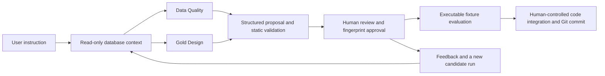

# Data Quality and Gold Design agents

Two small LangGraph paths use LangChain `ChatOpenAI` with the OpenAI Responses
API and structured output. The default model is `gpt-6-luna`. The existing
pipeline runs independently through `python -m src.cli`.



## Scope and value

| Agent | Generates | Why this task |
| --- | --- | --- |
| Data Quality | A standalone PySpark `transform(df)` for the cost/SLA silver component, supported by column observations and rule rationale | The profile includes negative costs, missing tokens and ambiguous SLA values. These provide measurable decisions beyond a generic cleaning description. |
| Gold Design | `CREATE VIEW candidate.report AS SELECT ...` for building operations, with grain, assumptions and reconciliation cases | Known-status denominators, recorded zero cost and unknown groups give specific correctness checks. |

User instructions and revision feedback guide each proposal within these component
contracts. Output includes `proposal.json`, candidate code and a manifest containing
stage order, entrypoint, inputs and outputs. Context includes schemas, source batch
hashes, a bronze profile, approved rules, open questions, and the small graph in
`knowledge.json`. Gold's fact/dimension relationships and cost dependencies are
explicit in that graph. Existing implementation code and evaluation answers are
not sent in generation prompts. Revision requests include the prior proposal.

## Run

Use the existing environment and initialized project database. Set
`OPENAI_API_KEY` in the launching shell. Keep it outside Git. The CLI reads shell
environment variables directly and does not load `.env`. `LLM_MODEL` optionally
overrides `gpt-6-luna`. This implementation uses Responses API features, so another
provider requires a compatible endpoint or its LangChain adapter and fresh evals.

```bash
uv run --locked python -m src.agents.cli propose data_quality --instruction "Generate cost and SLA cleaning using the approved rules; explain negative costs and SLA 999"
uv run --locked python -m src.agents.cli propose gold_design --instruction "Generate a building workload report with critical unresolved tickets and recorded-cost coverage"
```

Each command prints a new run directory under `data/processed/agent_runs/`.
Review its context, rationale, assumptions, code, manifest and validation cases.
Replace `RUN` below with that directory.

```bash
uv run --locked python -m src.agents.cli approve RUN --reviewer "Rahul"
uv run --locked python -m src.agents.cli evaluate RUN
```

For corrections, create a new run so the previous proposal and approval remain
available for comparison.

```bash
uv run --locked python -m src.agents.cli propose data_quality --instruction "Generate cost/SLA cleaning" --revise RUN --feedback "Preserve recorded zero costs and explain the denominator impact"
```

Approval records the reviewer's name, time and fingerprint of the exact inputs,
proposal, manifest and code. It authorizes evaluation only. Changes invalidate
that approval. It is a local reviewer attestation, without an authentication system.
After a passing evaluation and human review, integrate the component into a new
reviewed change and commit it to `main`. Structural SQL changes belong in a new
migration. The candidate manifest describes this handoff; the existing CLI does
not automatically execute candidate files or consume candidate manifests.

## Validation, evals and execution guardrails

Structured output is validated with Pydantic. DQ code is checked with Python AST
for its function, imports and obvious executable I/O. Gold code must be a single
view definition with a SELECT body. These are screening checks, not a Python
security sandbox. A human must review executable code before approval. Approved
Python runs in a separate process with a timeout and provider credentials removed
from its environment. It still has the reviewer's local filesystem permissions.
Gold's SELECT is evaluated in a read-only transaction with a statement timeout in
a disposable database. The evaluated query supplies the proposed view's contents.

DQ checks 13 fixtures covering missing tokens, zero, negative sentinels, currency
prefixes, invalid amounts, decimal precision, integer overflow and SLA 0/999. It
also checks types, IDs, row preservation and empty input. Gold checks an unknown
group, terminal/active/unknown statuses, zero/missing costs, grain and rate
denominators. `evaluation.json` records pass/fail and elapsed time. Passing these
fixed cases is a component-level gate, not proof for arbitrary future datasets.
Review changes against the existing pipeline before promotion.

`trace.json` records the run ID, model, execution source, prompt hash, response ID,
token usage, elapsed time and failure type. Input context and generated artifacts
are saved separately in the same run. Usage supports cost analysis; elapsed time
includes workflow overhead. Neither file asserts a monetary charge or time saved.
Generation uses a 120-second provider timeout, one retry and an 8,000-token output
limit. Profiles are bounded at 50,000 rows to prevent unbounded driver allocation.

## Repeatable offline verification

```bash
uv run --locked python -m src.agents.selftest
```

This exercises both LangGraph routes through the actual ChatOpenAI Responses
serialization using a simulated HTTP endpoint. It then saves artifacts, checks
approval, executes PySpark fixtures and the gold query, and rejects tampered runs.
It also verifies real bronze profiles, revision context, and invalid imports/SQL.
An intentionally incorrect SQL candidate must fail the numeric checks.
Temporary runs and the evaluation database are removed afterward.

`examples/cost_sla.py` and `examples/building_report.sql` are handwritten fixtures
for this offline test. The real model outputs are recorded separately below.

## Live examples and honest assessment

Both agents used `gpt-6-luna` through the Responses API. Each final proposal was
approved for isolated evaluation and passed its fixtures, then compared with the
full project dataset. These examples retain their exact prompts, profiles, model
output, manifest, token usage, approval fingerprint, evaluation and review history.

| Agent | Recorded input and output | Full-data validation |
| --- | --- | --- |
| Data Quality | [Context](examples/live/data_quality/context.json), [proposal](examples/live/data_quality/proposal.json), [PySpark](examples/live/data_quality/candidate.py) | All 10,280 input rows matched the approved cost/SLA parsers and flags. Other fields and lineage were preserved. Cost yielded 6,452 valid, 3,621 missing and 207 invalid amounts. SLA yielded 6,144 ordinary values, 3,086 missing, 1,041 requiring confirmation and 9 invalid values. |
| Gold Design | [Context](examples/live/gold_design/context.json), [proposal](examples/live/gold_design/proposal.json), [SQL](examples/live/gold_design/candidate.sql) | All columns and KPI values matched `gold.building_operations` across 19 groups and 10,254 accepted tickets. Counts and recorded costs reconciled to silver. |

The full comparison results are in each example's `full_dataset_evaluation.json`.
`evaluation.json` records the isolated fixture results. `review_history.json`
preserves earlier code, feedback, generation times and usage so the required
corrections can be inspected alongside the final result.

| Agent | Drafts | Total generation workflow time | Input / output tokens |
| --- | ---: | ---: | ---: |
| Data Quality | 5 | 96.826 seconds | 31,958 / 11,124 |
| Gold Design | 2 | 33.001 seconds | 10,848 / 3,078 |

Times sum the recorded generation calls and their local workflow overhead.
They exclude reviewer time and evaluation. Tokens include all drafts and are
usage measurements, not an invoice or a measurement of time saved.

**Data Quality assessment.** It produced a reviewable first draft with rationale,
but needed four correction rounds for currency parsing, null handling, negative
SLA checks, expression ordering, regex escaping and decimal precision. For this
small, already-defined component, reviewing and correcting it was more trouble
than writing the rule directly. The demonstration supports assisted drafting and
review, with no demonstrated development-time saving.

**Gold Design assessment.** It produced the requested report grain and most KPI
calculations quickly. One correction was needed because it used raw status
spellings instead of silver's canonical underscore-separated values. The second
draft matched the published report. Its useful contribution was a structured SQL
draft, but schema-aware review and denominator checks were still necessary.
Trust follows the validated grain, vocabulary and reconciliation checks. Override
the output when it guesses business meanings or contradicts approved rules.

No reference implementation was supplied to the generation prompts. Revision
feedback supplied explicit fixes, including concrete regex guidance for DQ.
These results describe this dataset and the recorded reviewer assistance; they
do not establish general model accuracy. The candidates remain evaluation artifacts
pending a separately reviewed integration into the working pipeline.

## Scale and deliberate limits

At 1M–10M rows, compute database/Spark aggregates and bounded representative
examples, and cache profiles by input hashes and schema version. Keep model calls
at the dataset/component level rather than per row. Reuse unchanged context and
batch independent generation/evaluation tasks when needed. The current profiler
is intentionally limited to the take-home's local dataset.

This MVP demonstrates two components, a small explicit dependency graph and
human-controlled revisions. Data-governance policies and classification frameworks
are outside the agreed scope. Agent-created code never changes the existing
solution automatically. Live access, fixture evaluation and full-dataset agreement
have been verified for the two recorded final candidates.
